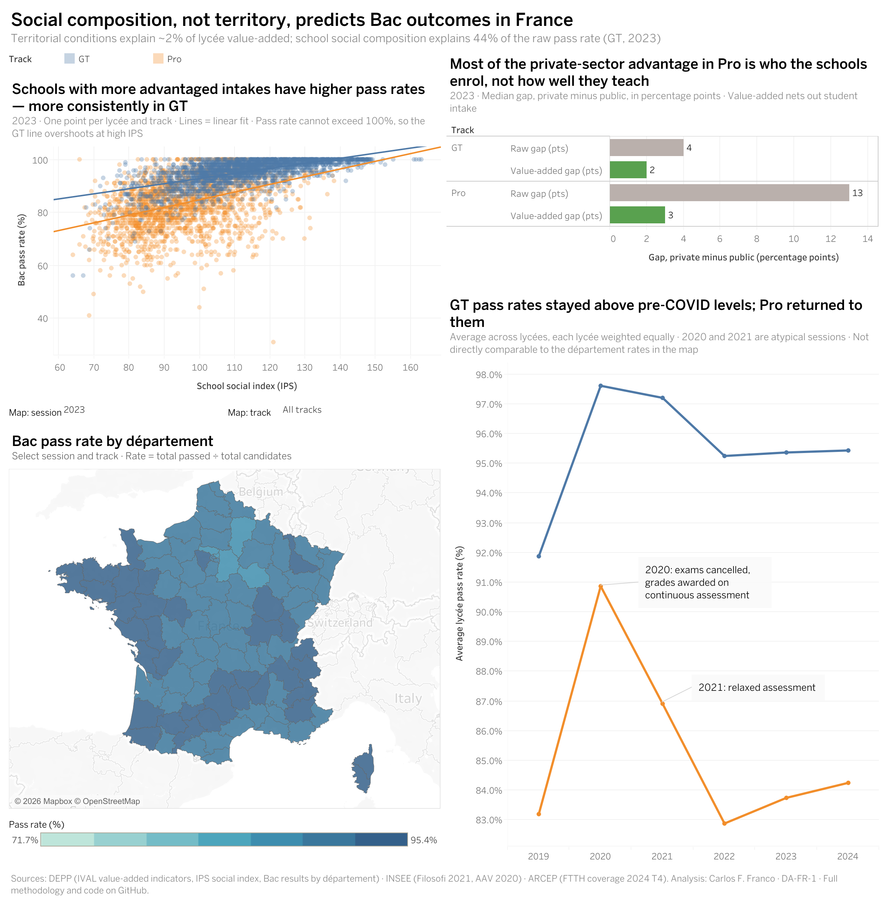

# Digital Divide & Post-COVID Educational Inequality in France

**Project code:** DA-FR-1 · **Analyst:** Carlos F. Franco
**Status:** Complete — all five stages (last updated: November 2026)

> The analysis is finished. The final report, the executive deck and the interactive
> dashboard are linked under [Deliverables](#deliverables) below.

---

## Research question

**What socioeconomic and territorial factors predict Baccalauréat outcomes across French lycées in the post-COVID period?**

The analysis tests whether municipal-level conditions — broadband infrastructure,
household income, poverty, urban/rural location — explain variation in school
performance once student intake composition is accounted for.

| Field | Value |
|---|---|
| Unit of analysis | Lycée (upper secondary school) |
| Regression frame | 2023 cross-section, 4,340 lycée-track observations (GT 2,331 / Pro 2,009) |
| Descriptive panel | 2019–2024, 60,743 school-year observations |
| Geography | France (metropolitan + overseas départements) |
| Data sources | 9 public administrative datasets |
| Inference | CR2 cluster-robust, clustered by commune (1,337 clusters) |
| Language of analysis | R 4.5.1 |

---

## Headline result

**Territorial conditions explain roughly 2% of the variation in lycée value-added.
On their own they explain 9.1% of the variation in the raw pass rate in the general
track; once the school social index is included, the model explains 44.1%.**

Post-COVID educational inequality in France, as measured here, lives in *who attends
each school* — not in the municipality around it.

---

## Deliverables

| Deliverable | Where |
|---|---|
| Final report | [`final_report.md`](final_report.md) |
| Executive deck (PDF, 7 slides) | [`output/deck/DA-FR-1_deck.pdf`](output/deck/DA-FR-1_deck.pdf) |
| Interactive dashboard | [Tableau Public](https://public.tableau.com/app/profile/carlos.oaxaca/viz/DA-FR-1SocialcompositionnotterritorypredictsBacoutcomesinFrance/Dashboard) |

[](https://public.tableau.com/app/profile/carlos.oaxaca/viz/DA-FR-1SocialcompositionnotterritorypredictsBacoutcomesinFrance/Dashboard)

---

## How this project is run

The project is executed under a **multi-role structure modelled on institutional
analytical practice**: a *project lead* role responsible for scope, quality control and
phase gating, and an *analyst* role responsible for execution. Both roles are performed
by the author.

The separation is deliberate. Each stage closes with a written report that must be
reviewed and signed off before the next stage may begin. The purpose is to force the work
through critical scrutiny at every gate rather than let it advance unquestioned —
reviewing one's own analysis from an explicitly different vantage point is not the same as
reviewing it from the position that produced it.

This is why the reports in this repository carry sign-off and gating language. The
convention is the object of the exercise, not decoration.

**It has caught two real errors, both documented rather than quietly fixed.**

The first was an effective-N figure certified in Stage 1 that was arithmetically
impossible: the listwise-deletion set had been built on median income but omitted the
poverty rate, which carries additional missing values from small-commune suppression. The
contradiction surfaced against the project's own Stage 2 missing-value table. Recertified
figures were issued as a written erratum at the head of Stage 3; Stage 1 was not
retroactively edited.

The second was a p-value discrepancy. The table generator applied the correct cluster-robust
standard errors but derived p-values from large-sample degrees of freedom, overstating
significance on six coefficients — precisely those already flagged as weakly identified. It
was caught by comparing the generated tables against the analyst's own diagnostic output,
and resolved in code rather than by footnote.

---

## Analytical design

Five specifications, four of which are estimated across both tracks — eight estimations in total.

| Model | Dependent variable | Predictors | Status |
|---|---|---|---|
| **A** (primary) | IVAL value-added score | fibre coverage, median income, poverty rate, urban/rural | ✅ Estimated |
| **B** (secondary) | Raw Bac pass rate | Model A predictors + school social index (IPS) | ✅ Estimated |
| **B+** | Raw Bac pass rate | Model B predictors + school sector | ✅ Estimated |
| **A+** | IVAL value-added score | Model A predictors + school sector | ✅ Estimated |
| **C** (descriptive) | Pass rate by département | mapping only | ✅ Delivered — département map in the dashboard |

**Recertified effective N** (supersedes the Stage 1 figures):

| Track | Model A | Model B | Model B+ | Model A+ |
|---|---|---|---|---|
| GT | 2,243 | 2,237 | 2,237 | 2,243 |
| Pro | 1,909 | 1,907 | 1,907 | 1,909 |

### Three design choices that define the project

**Track stratification.** All analysis is run separately for the *general/technological*
(GT) and *vocational* (Pro) tracks. The two are never pooled. They differ in outcome
distribution (median pass rate 97% vs 84%), in social composition (IPS 113 vs 96) and in
association structure (IPS↔pass rate r = 0.63 vs 0.40) — pooling would average two
distinct regimes into one uninterpretable coefficient. Stage 3 confirmed the choice
repeatedly: the sector effect, the fibre result and the movement in the social index
coefficient all differ by track.

**Value-added as primary outcome.** The raw pass rate hits a hard ceiling in the GT track:
a linear fit extrapolates above 100% at high social index values, which is an impossible
prediction. The IVAL value-added measure, which nets out intake composition, is used
instead. The school social index is deliberately excluded from Model A to avoid
circularity — a theoretical claim that was **empirically verified** on this dataset before
being relied upon (correlation of 0.05 GT / 0.00 Pro).

**Commune-clustered standard errors.** Schools in the same commune share identical
territorial predictor values, so residuals are correlated within commune and conventional
standard errors are downward-biased on precisely the headline predictors. Inference uses
CR2 cluster-robust standard errors with Satterthwaite degrees of freedom, reported
alongside classical ones.

---

## Current state

| Stage | Status |
|---|---|
| 0 — Framing and design | ✅ Complete |
| 1 — Data preparation and merge pipeline | ✅ Certified (effective-N erratum issued at Stage 3) |
| 2 — Descriptive statistics and EDA | ✅ Complete and signed off |
| 3 — Regression analysis | ✅ Complete and certified |
| 4 — Visualisation and dashboard | ✅ Complete |
| 5 — Reporting and communication | ✅ Complete |

---

## Results

Full tables in `output/tables/` — four specifications per track, CR2 cluster-robust
standard errors, Satterthwaite p-values, recertified N and R² in the footer. The full
narrative, the limitations and the four policy implications are in
[`final_report.md`](final_report.md); the model-by-model detail is in
[`regression_report.md`](regression_report.md).

**1 — Territorial conditions do not explain lycée value-added.** Model A accounts for
1.9% of variance in the general track and 0.4% in the vocational track, where it is not
jointly significant (CR2 Wald p = 0.281). This outcome was declared in writing before
estimation.

**2 — Social composition dominates.** Territorial variables alone explain 9.1% of the
variance in the raw pass rate in the general track and 5.2% in the vocational track. Once
the school social index is included, the model explains 44.1% and 17.6% respectively, on
the same observations, with a cluster-robust t-statistic of 30.4 on the index in the
general track — the largest in the study by a wide margin.

The regression report states this result as a rise "from 1.9% to 44.1%". That comparison
sets two different outcomes side by side: value-added in Model A and the raw pass rate in
Model B. The final report corrects it. The figures above are the corrected ones: a
territorial-only descriptive baseline (Model B0 in `05_regression.R`) against Model B,
both on the raw pass rate.

**3 — In the vocational track, most of the socioeconomic gradient runs along the
public/private divide.** Adding sector reduces the social index coefficient by 64% in Pro
(0.276 → 0.100) and raises R² from 17.6% to 32.3%. In GT the same adjustment moves the
coefficient by only −17.8%.

**4 — Roughly three quarters of the private-sector advantage in the vocational track is
intake composition.** A raw 13-point gap decomposes into approximately 9.75 points of
composition and 3.25 points net of intake. The contrast between tracks is itself a
finding: in GT the sector coefficient barely moves between specifications (−1.91 → −1.90),
so the social index alone already captures essentially all of the between-sector intake
difference. In Pro it moves from −9.83 to −3.25, so a single summary index leaves a large
part of that difference unmeasured. One index describes GT intakes adequately; it does not
describe Pro intakes adequately.

**5 — Sector is the only predictor that explains value-added in the vocational track.**
Model A in Pro is jointly null; adding sector raises R² elevenfold and the model becomes
jointly significant, with no territorial predictor reaching significance.

**6 — Broadband coverage shows a small negative association with value-added in GT** —
contrary to the digital-divide hypothesis and to the pre-registered expectation. It
survives sparse-tail exclusion, loses 45% of its magnitude and falls below conventional
significance under département fixed effects, and is not robust in Pro. It is reported
without a proposed mechanism.

**7 — Commune poverty does not predict value-added within départements.** The positive
coefficient in Model A vanishes entirely (p = 0.994) once regional fixed effects are
introduced.

**8 — Clustered inference changes precision asymmetrically.** Cluster-robust standard
errors rise 22–35% relative to classical inference on exactly the territorial predictors
the study was designed to test. Sector is barely affected, because it varies *within*
communes — a town can have both a public and a private lycée — while territorial
predictors are constant within a commune by construction. This is why sector is estimated
far more precisely than any territorial variable, and why it rescues the vocational model
where no territorial predictor can.

### Pre-registered expectations: three of four held

The low R² in both tracks and the dominance of social composition were declared in advance
and confirmed. The expectation that broadband coverage would be non-significant did not
hold. The response was investigation — six robustness checks — not respecification. The
headline specification was not switched to whichever refit produced a more convenient
coefficient.

---

## Repository structure

```
DA-FR-1/
├── DA-FR-1.Rproj              # open the project via this file
├── .gitignore
│
├── 01_reconnaissance.R        # loads and inspects the 9 raw datasets
├── 02_build_join_inputs.R     # builds 6 validated input frames
├── 03_execute_joins.R         # merges, derives variables, writes .rds artefacts
├── 04_eda.R                   # Stage 2 exploratory analysis
├── 05_regression.R            # Stage 3 models, diagnostics, robustness, tables
├── 06_dashboard_data.R        # Stage 4 — exports the three dashboard datasets
│
├── intake_report.md           # Stage 1 Step 1 — signed off
├── join_readiness_report.md   # Stage 1 Step 2 — signed off
├── integrity_report.md        # Stage 1 Step 3 — certified, one figure superseded
├── eda_report.md              # Stage 2 — signed off
├── regression_report.md       # Stage 3 — certified
├── final_report.md            # Stage 5 — final report
│
├── docs/
│   └── decision_log.md        # analytical decisions in ADR format
│
├── data/
│   ├── raw/                   # 9 source files, never modified — versioned
│   └── processed/             # generated artefacts — not versioned
│
└── output/
    ├── dashboard_data/        # three CSV files read by the dashboard
    ├── deck/                  # executive deck, 7 slides (PDF)
    ├── figures/               # 18 figures: 13 from Stage 2 (300 dpi), 5 dashboard captures — versioned
    ├── tableau/               # Tableau Public workbook (.twbx)
    └── tables/                # coefficient tables, GT and Pro
```

---

## Requirements

**R 4.5.1** or later. Install the packages used across the full pipeline:

```r
install.packages(c("tidyverse", "readxl", "clubSandwich", "car", "lmtest", "modelsummary"))
```

`tidyverse` and `readxl` cover data handling and source ingestion; `clubSandwich` provides
the CR2 cluster-robust estimator; `car` and `lmtest` supply the diagnostic tests; and
`modelsummary` builds the coefficient tables.

## Reproducibility

Run the scripts in order from a clean R session:

```
01_reconnaissance.R  →  02_build_join_inputs.R  →  03_execute_joins.R  →  04_eda.R  →  05_regression.R  →  06_dashboard_data.R
```

Scripts `02` and `03` regenerate all processed artefacts from the raw sources. No manual
step is required at any point in the R pipeline. The dashboard is the one exception: it
was assembled by hand in Tableau Public from the three files that script `06` exports.

**Versioning policy.** Raw source data is versioned to guarantee reproducibility and to
preserve the exact snapshot the analysis was run on — several publishers overwrite their
files periodically. Processed artefacts are not versioned, as they are deterministically
regenerated by the pipeline. Code and figures are versioned.

**Verification standard.** No script is committed until it has been verified to run from a
clean session (`Session → Restart R`, then `source()`). Commits follow Conventional Commits
and are atomic — one logical change each. Commit and push happen together: a commit that
has not been pushed is not backed up.

---

## Data sources

| Source | Publisher | Content |
|---|---|---|
| IVAL (GT and Pro) | DEPP — Ministry of Education | School value-added indicators, 2023 |
| IPS Lycées 2022, 2023 | DEPP | Social position index by school |
| Annuaire de l'éducation | Ministry of Education | School directory and commune crosswalk |
| Bac results by département | DEPP | Pass rates, 2023–2025 |
| Filosofi 2021 (COM) | INSEE | Median income and poverty rate by commune |
| ARCEP MCI 2024T4 | ARCEP | FTTH broadband coverage by commune |
| AAV 2020 | INSEE | Urban/rural classification |

**Licences.** All nine source files are published under the *Licence Ouverte / Open
Licence 2.0* (Etalab), which allows reuse with attribution. The licence was checked for
each source on 14 November 2026.

| Source | File in `data/raw/` | Licence stated on |
|---|---|---|
| IVAL, general and technological | `ival_gt_lycees_2023.csv` | [dataset page](https://data.education.gouv.fr/explore/dataset/fr-en-indicateurs-de-resultat-des-lycees-gt_v2/), data.education.gouv.fr |
| IVAL, vocational | `ival_pro_lycees_2023.csv` | [dataset page](https://data.education.gouv.fr/explore/dataset/fr-en-indicateurs-de-resultat-des-lycees-pro_v2/), data.education.gouv.fr |
| IPS Lycées 2022 | `ips_Lycees_2022.csv` | [dataset page](https://data.education.gouv.fr/explore/dataset/fr-en-ips-lycees-ap2022/), data.education.gouv.fr |
| IPS Lycées 2023 | `ips_Lycees_2023.csv` | [dataset page](https://data.education.gouv.fr/explore/dataset/fr-en-ips-lycees-ap2023/), data.education.gouv.fr |
| Annuaire de l'éducation | `rep_annuaire_edu_V2.xlsx` | [dataset page](https://data.education.gouv.fr/explore/dataset/fr-en-annuaire-education/), data.education.gouv.fr |
| Bac results by département | `bac_par_departement_2023_2025.csv` | [dataset page](https://data.education.gouv.fr/explore/dataset/fr-en-baccalaureat-par-departement/), data.education.gouv.fr |
| Filosofi 2021 (COM) | `cc_filosofi_2021_COM.csv` | [INSEE legal notice](https://www.insee.fr/fr/information/2008466), which covers every file on insee.fr unless stated otherwise ([dataset page](https://www.insee.fr/fr/statistiques/7756855)) |
| AAV 2020 | `aav2020_urban_rural.xlsx` | Same INSEE legal notice ([dataset page](https://www.insee.fr/fr/information/4803954)) |
| ARCEP MCI 2024T4 | `arcep_mci_commune_2024T4.csv` | [dataset page](https://www.data.gouv.fr/datasets/ma-connexion-internet/), data.gouv.fr |

Sources: DEPP and DNE (Ministère chargé de l'éducation nationale), Insee, Arcep. The
files are stored unchanged, as added to this repository in June 2026.

---

## Documented methodological decisions

Substantive choices departing from the original brief are logged with their rationale,
including track stratification, a dual commune-key strategy resolving a granularity
mismatch between datasets, a three-level urban/rural recoding, the correction of a silent
numeric conversion failure caused by French decimal commas combined with INSEE
statistical-secrecy codes, the choice of cluster level and estimator for inference, and the
resolution of the p-value discrepancy in code.

The *brief* is the project's design document, written at Stage 0 before any data was
loaded: it fixed the research question, the model architecture and the planned checks.
The *dataset guide*, which the decision log also cites, is the Stage 0 plan for acquiring
and joining the sources. Both are internal planning documents and are not included in
this repository.

Full decision log: [`docs/decision_log.md`](docs/decision_log.md)

One claim in the original brief has been **formally withdrawn**: a panel fixed-effects
robustness check on territorial predictors is not identified, since single-vintage
territorial variables demean to zero under school fixed effects.

---

## Known limitations

- The broadband snapshot is 2024, measured against a 2020–21 exposure window; it is framed
  as a proxy for persistent territorial infrastructure, not contemporaneous exposure.
- Income data carries a two-year lag relative to the outcome year.
- Fibre coverage is a supply-side availability measure, not actual household usage.
- The social index definition breaks between the 2022 and 2023 files; it has been
  harmonised to a common schema and the break is caveated wherever adjacent years are
  compared.
- The rural category is thin (22 GT / 34 Pro schools). It is retained because dissolving it
  would make a rural effect unmeasurable by construction, but its coefficient is reported
  and not interpreted.

Three planned checks were **not run**, and are declared rather than omitted:

- **Influence diagnostics** (Cook's distance) on the vocational value-added outliers.
- **Adjacent-year coefficient stability**, which was the replacement for the withdrawn
  panel fixed-effects check — so temporal stability of the coefficients is unverified.
- **A continuous population-density control**, which would have tested the most plausible
  explanation for the broadband association reported in result 6.

An OECD benchmarking comparison, planned at the design stage, was not carried out.

The final report discusses these limitations in full and adds three: commune data describe
where the school is and not where its students live, the design is a cross-section, and
value-added is the Ministry's own model ([Section 4](final_report.md#4-limitations)).

---

## Author

**Carlos F. Franco** — Economist working in data analysis for social impact
MBA in Technology for Business (AI, Data Science, Big Data), PUCRS
